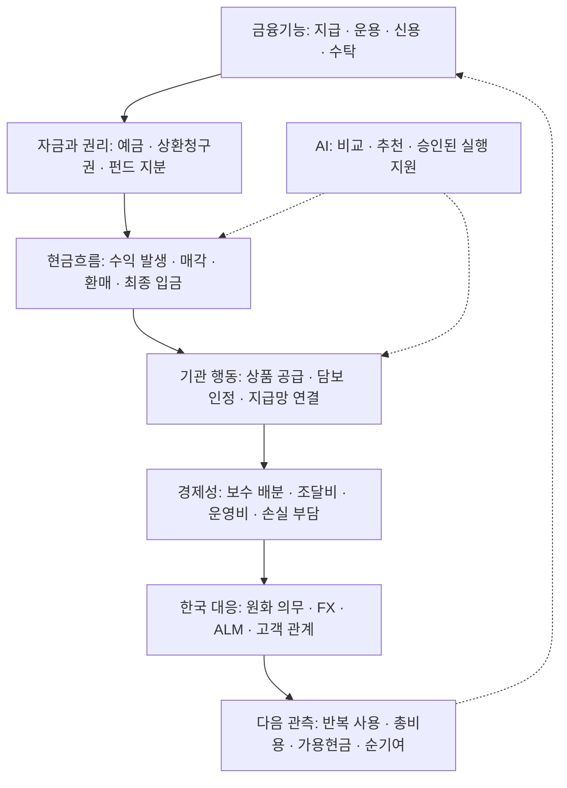

# 2026-10 · 디지털 금융의 변화와 기관의 선택

**돈을 보내고, 운용하고, 필요할 때 현금으로 바꾸는 과정에서 누가 고객·권리·수익·위험을 맡는가?** 2026년 10월 이후 수정한 금융·AI·경제 연구를 이 질문으로 연결한 공개 연구 포트폴리오다. 기준 확인일은 **2026-11-01 UTC**다.

## 최종 보고서

**[디지털 금융환경의 변화와 한국 금융기관의 대응 — 2026-11-01](reports/digital-finance-institutional-response-2026-11-01.md)**

10월 초 보고서와의 변화 비교부터 금융기능·자금·권리·기관별 수익, 한국의 업무 사례, 미래 시나리오와 다음 관측까지 한 문서로 읽는 Markdown 종합본이다. 사례 카드는 아래에서 세부 주제별로 이어 읽을 수 있다. 금융위 입법예고문의 추가 확인 내용은 종합본에 반영했다.

## 전체 흐름

아래는 확인된 사건의 연표가 아니라 **분석 순서와 조건부 전달 경로**다. 화살표마다 계약·실사용·비용의 증거가 필요하다.

## 사례로 내려가기

| 질문 | 사례 카드 | 현재 근거 수준 |
|---|---|---|
| 지급용 달러와 수익형 자산은 어떻게 연결되는가? | [01 · 디지털 달러와 토큰화 자산](cases/01-money-and-assets.md) | 공식 약관·기관 발표 + 조건부 해석 |
| 토큰을 받으면 보험금 지급 준비가 끝나는가? | [02 · 보험사의 현금관리](cases/02-insurance-liquidity.md) | 업무 설계·가상 PoC, 실제 지급 성과 미확인 |
| 한국 은행은 무엇을 지키고 어디서 수익을 얻는가? | [03 · 한·미 지급과 은행 조달](cases/03-korea-bank-response.md) | 기술 실증·파일럿 설명 + 경쟁 시나리오 |
| 더 많은 권리를 상품화하면 가치도 자동으로 늘어나는가? | [04 · RWA의 권리와 현금흐름](cases/04-rwa-rights.md) | 합성 검토 사례 + 조건부 사업 가설 |
| AI가 연구와 금융 선택을 맡을 때 무엇을 검증할까? | [05 · 경제 기억과 AI 위임](cases/05-ai-research.md) | 개발용 공시 검토 실험, 일반 성능 미검증 |
| AI 기술 변화는 기업 현금흐름과 금융 판단으로 어떻게 이어지는가? | [06 · AI 인프라와 실물 조달](cases/06-real-economy.md) | 논문 보고·산업 해석·합성 조달 사례 |

**지금의 판단 — 자체 해석:** 한국 금융기관은 고객의 원화 지급의무와 달러 접근, 적법한 상품·담보·현금화, 오류 복구를 함께 설계할 필요가 있다. 같은 고객·통화·지급시각을 고정하고 기존 계좌/API+AI와 온체인 경로의 총비용을 비교해야 한다. 비용 절감이 경쟁으로 고객에게 이전되면 공급자의 이익은 늘지 않을 수도 있다.

[공식 근거와 재확인 한계](SOURCES.md) · [조사 범위·귀속·검증](METHOD.md)

**읽는 기준:** 사실 / 기관주장 / 자체해석 / 조건부가설 / 미확인을 구분한다. 발표와 실행, 잔액과 거래량, 합성 테스트와 실제 성과는 서로 다른 증거다. AI가 자료 확인·요약·편집을 지원했다. 독립적인 사람의 검토를 입증하지 않았다.

## 보험 업무 연구와 합성 실험

[환경 → 문제 → 검증 → 기여 패키지](kb/README.md)와 [4쪽 발표본](kb/portfolio_4pages.md): 현재 행정 검토와 미래 시설 의존성의 두 합성 실험, 사전 평가계획, SQL 비교, 원결과 및 한계를 함께 남겼다. 실제 지급 판단·운영효과를 주장하지 않는다.

[금융기관 연구보고서 HTML](kb/portfolio.html)

[연구보고서 본문 Markdown](kb/insurance_financial_environment_report.md) — 요약과 5장, 참고자료 및 합성실험 방법론 부록.

[온체인 RWA 보장·위험관리 업무 재설계](kb/business_redesign_proposal.md) — 유한한 인수자본과 유동성 아래 권리, 보장상태와 공통위험을 연결하는 조건부 제안.
