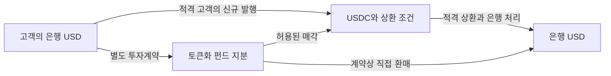

# 01 · 지급용 디지털 달러와 수익형 자산

[전체 흐름으로](../README.md)

**금융기능:** 지급에 쓸 잔액과, 대기하는 동안 수익을 얻는 자산을 연결한다. 핵심은 토큰 이름보다 청구권과 현금화 계약이다.

## 확인한 출발점

- **사실·약관:** Circle의 2026-10-15판 USDC 약관 §1–2는 USDC 자체의 이자 권리를 부여하지 않으며, 직접 상환에 Circle Mint 계정 자격을 요구한다. 준비자산 수익과 보유자의 투자수익은 다르다. [USDC 약관](https://www.circle.com/legal/usdc-terms)
- **기관주장:** 2026-10-29 표시 준비금 페이지는 USDXX와 은행 현금 등의 구조를 설명한다. USDXX는 BUIDL과 별도 상품이다. 동적 잔액 숫자는 이번 조회에서 확보하지 않아 사용하지 않았다. [준비금 공개](https://www.circle.com/transparency)
- **기관 발표·역사적 사건:** Circle은 2024-04-11 BUIDL 지분을 Circle에 넘기고 USDC를 받는 2차시장 기능을 발표했다. 이는 펀드 직접 환매나 은행 달러 입금 완료와 다르다. 현재 고객별 호가·한도·실사용은 미확인이다. [전환 기능 발표](https://www.circle.com/pressroom/circle-announces-usdc-smart-contract-for-transfers-by-blackrocks-buidl-fund-investors)

## 기관 행동과 손익 — 자체해석

발행사는 지급잔액과 유통망, 운용사는 유료 운용잔액, 은행·수탁사는 현금 접근과 자산 보관을 확보하려 한다. 발행사의 경제성은 평균 준비자산과 수익률뿐 아니라 유통 배분·상환·준법 비용에 달려 있다. 운용사의 AUM은 회사 매출이나 자기자본이 아니다.

**조건부가설:** 수익형 자산에서 지급 직전에만 USDC로 전환할 수 있다면 같은 결제량을 더 작은 평균 지급잔액으로 처리할 수 있다. 반대로 이용자와 사용처가 늘면 양쪽 잔액이 함께 커질 수 있다. 결제량 증가만으로 발행사 이익 증가를 확정할 수 없다.

**한국 대응 후보:** 증권·운용사는 상품 권리·환매·수탁을, 은행은 FX·은행 입금·비상 유동성을 연결한다. 보수는 실제 역할과 책임에 맞춰 계산한다. 한국 법인의 가입·취급 허용은 상품별로 별도 확인해야 한다.

**다음 판별자료:** 신규 발행과 기존 토큰 이전, 평균 잔액과 결제량, 펀드 순납입과 기존 클래스 이동, 유통비 차감 수입, 최종 은행 입금시간. 달러 접근 확대가 국채 수요를 늘린다는 가설은 전환 전 자산과 다른 보유자의 매도·환매까지 대사해야 한다.
