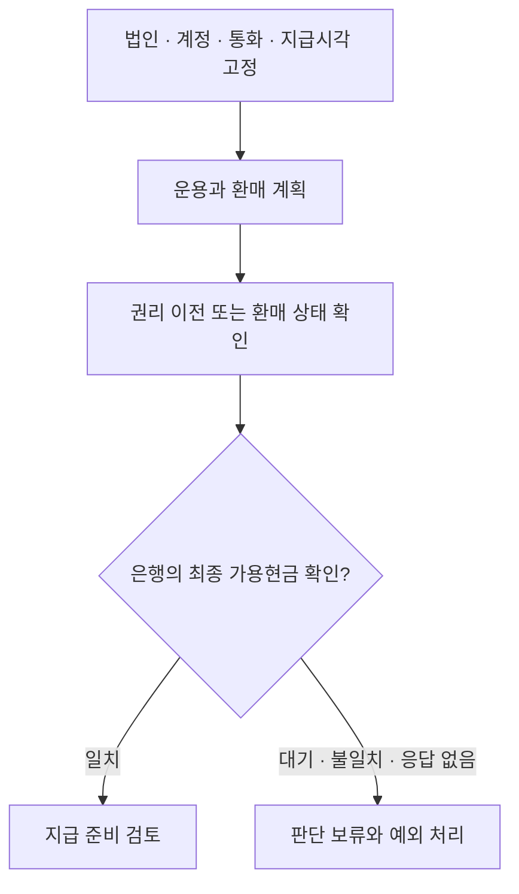

# 02 · 보험사의 현금관리: 기록에서 지급 준비까지

[전체 흐름으로](../README.md)

**금융기능:** 보험사는 장기 부채를 충당하면서 지급일의 현금과 헤지·담보 의무를 맞춘다. 외화자산 총액을 여유현금으로 취급할 수 없다. 이 사례는 특정 보험사의 실제 토큰 보유·계약을 확인한 결과가 아니라 연구 설계다.

## 같은 업무를 네 방식으로 비교한다

| 비교 경로 | 분리해서 측정할 효과 |
|---|---|
| 기존 상품·계좌 + 사람 | 현재 지급 안정성·전체 원가의 기준선 |
| 기존 상품·계좌 + AI | 예측·대사 지원의 추가 편익과 검토 비용 |
| 온체인 경로 + 사람 | 권리 기록·이전·담보의 변화와 전환 비용 |
| 온체인 경로 + AI | 기존 AI 경로에 온체인을 더할 가치와 복합 장애 |

**자체해석:** 같은 스트레스 지급능력을 유지하면서 대기자금·긴급차입·처리비를 줄여야 경제적 편익이다. 기초자산 수익을 기술 편익으로 다시 더하지 않는다. 장기채를 단기 토큰펀드로 바꾸면 듀레이션과 재투자위험도 바뀐다.

## 직접 만든 사례가 보여주는 범위

비공개 연구의 보험 유동성 PoC는 Docker의 앱·로컬 EVM·모의 은행을 나눈다. 가상 예상 정산액 **100만 원**에 대해 정상, 은행 입금 대기, **90만 원** 입금 불일치를 구분한다. 준비계좌 입금 확인도 보험금 지급 완료가 아니다.

**사실·코드 확인:** 단위검사 6개와 서비스 검사 3개 정의를 확인했다. **이번 작업에서는 실행하지 않았다.** 실은행·실제 BUIDL·USDC 연결, 고객 지급, 시간·비용 절감의 증거가 아니다. [공식 전환 구조의 비교 기준](https://www.circle.com/pressroom/circle-announces-usdc-smart-contract-for-transfers-by-blackrocks-buidl-fund-investors)

**조건부가설:** 토큰화 자산이 계약상 담보로 인정되고 정해진 통화로 기한 내 현금화된다면 분산 선예치가 줄 수 있다. 반대 경로는 상시 마진콜·동시 환매가 현금 수요를 더 키우는 경우다.

**한국 대응 후보:** 보험사는 ALM·지급 한도, 운용사는 포트폴리오·환매 계획, 증권·은행은 적법한 집행·FX·현금 연결을 맡는다. 계열사 보수는 그룹 합산 시 내부거래를 제거하고 외부 순기여와 내부 자원비를 본다.

**다음 판별자료:** 실제 자금의 법인·계정·지급 일정, 가입 가능한 상품 계약, 환매·은행 입금 SLA, 헤어컷과 스트레스 자금, 자본·회계·외환 검토. 이 조건을 확보하기 전 실제 운용 우열은 **미확인**이다.
