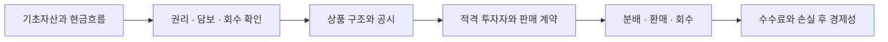

# 04 · RWA: 상품의 수보다 권리·회수·비용

[전체 흐름으로](../README.md)

**금융기능:** 자금 수요자의 현금흐름을 투자자의 권리로 연결한다. 토큰 기록이 생겨도 소유권, 상환순위, 수탁·담보권, 현금흐름의 신뢰성은 따로 확인해야 한다.

**사실·자체 실험 기록:** 공개 `sto-ai-frontier`의 저장 결과는 합성 자산 8건·합성 문서 10건을 검토했다. `READY_FOR_INTERNAL_REVIEW`는 합성 조건을 충족한 내부 검토 후보다. 저장 보고서의 발행 승인·공시 승인은 각각 0건이다. 권리 불확실성을 높은 상환배율로 덮어 통과시키지 않는 코드도 확인했다. 이번에 코드를 재실행한 결과는 아니다. [고정 결과](https://github.com/Eom-TaeJun/sto-ai-frontier/blob/d64f570467204e2fdfa5be86ea456a501191b9f8/outputs/reports/decision_brief.md) · [검사 코드](https://github.com/Eom-TaeJun/sto-ai-frontier/blob/d64f570467204e2fdfa5be86ea456a501191b9f8/tests/test_controls.py)

**자체해석:** AI가 문서 대조비를, 토큰화가 기록·이전비를 낮춰도 기초자산 부도와 법적 회수비는 남는다. 금융기관은 발행·관리·수탁의 보수를 얻을 수 있지만 검토·분쟁·유동성 공급비와 손실 부담을 함께 가진다. [실제 상품의 매각·지급 연결 사례](https://www.circle.com/pressroom/circle-announces-usdc-smart-contract-for-transfers-by-blackrocks-buidl-fund-investors)는 모든 RWA의 유통성을 보장하지 않는다.

**조건부가설 — 상품화 가능한 범위의 확대:** 표준계약·AI 검토·권리 기록의 건당 고정비가 낮아지면 작은 채권·로열티 등도 상품 후보가 될 수 있다. 이는 자본이나 안전자산이 무한히 생성된다는 뜻이 아니다. 발행 비용이 낮아질수록 진위 확인·신용심사·회수·매수 유동성이 새로운 병목이 될 수 있다.

**반대 시나리오:** 비표준 권리의 검증·소송 비용이 그대로거나, 투자자 수요가 없거나, 공급 확대가 보수를 낮추면 총수익은 개선되지 않는다. 현재 미상용화만으로 장래 가능성을 없애지 않고, 이 조건을 검증할 작은 실험을 남긴다.

**한국 대응 후보·다음 관측:** 증권사는 발행·판매 계약과 적합성을, 운용사는 기초현금흐름과 가치평가를, 수탁기관은 권리·보관·반환을 검토한다. 같은 자산군의 반복 발행, 사람이 검토한 총시간, 외부 투자자의 재구매·회수, 손실 후 기여이익이 확인될 때 확대한다. 국내 허용 범위는 [미확인 규제 항목](../SOURCES.md)을 먼저 해소한다.
