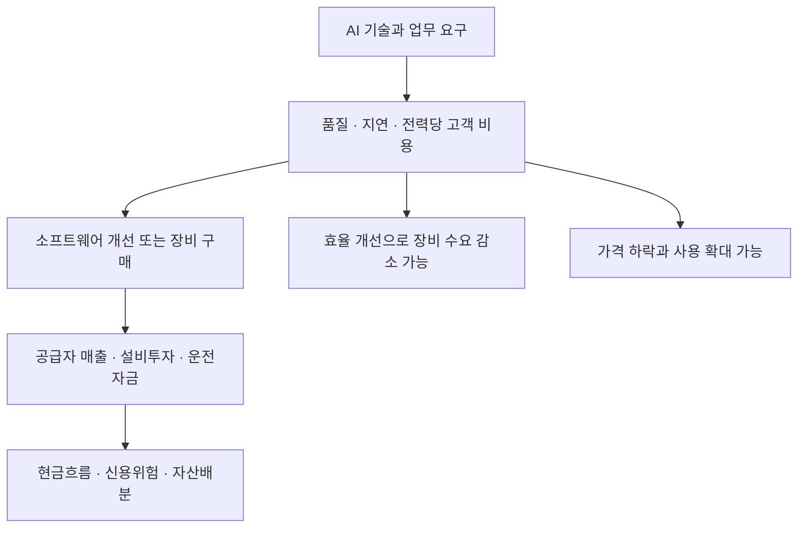

# 06 · AI 인프라와 실물 조달을 금융 판단에 연결하기

[전체 흐름으로](../README.md)

**금융기능:** 실물기업의 구매·투자·운전자금 수요를 이해하고 신용·자산배분에 연결한다. 기술 채택과 공급자의 이익 사이에는 고객의 구매 결정이 있다.

**연구자 주장·기술 시험:** PagedAttention 논문 v1(2023-09-12)은 KV 메모리 관리 개선과 특정 비교 시스템 대비 같은 지연에서 처리량 2–4배를 보고했다. 이 결과는 신규 메모리 구매량·금융기관 ROI의 증거가 아니다. [논문 초록](https://arxiv.org/abs/2309.06180v1)

**자체해석:** `sk`와 산업 거래구조 연구는 고객의 용량·대역폭·전력·저장 요구를 제품 구매와 연결한다. 요청당 자원 사용이 줄어도 서비스 수요가 더 늘면 총수요는 커질 수 있다. 반대로 소프트웨어·모델 변화가 고가 메모리 수요를 대체할 수 있다. 전력·설치·인증·출하·가동·매출·현금 지출은 각각 다른 관측이다. [공개 구조 분석 고정본](https://github.com/Eom-TaeJun/sk/blob/ec6b6c2d31f3615d3372ce43cffb36d80a18d0e5/docs/research/supply_chain/structural_market_scenarios.md)

**보조 사례·합성 설계:** `soil`은 도착 예정 재고와 실제 사용 가능 재고를 구분하고 조기 조달·대체 대안을 비교한다. 가격과 물량은 회사 내부 데이터가 아닌 합성 조건이다. 저장소의 252개 조건 조합 검증 절차는 확인했지만 이번에는 실행하지 않았다. 실제 구매 가능성·절감액·기업 최적안은 미확인이다. [설계와 경계](https://github.com/Eom-TaeJun/soil/blob/266eab0b236b354f6d65272ade4bdd69a9f0bc03/cowork/2026-10-14-supply-decision/README.md)

**연결되는 논리:** 자산 장부에 있다는 것과 지급에 쓸 수 있다는 것이 다르듯, 선박이 도착한다는 것과 생산에 투입할 재고가 확보된다는 것도 다르다. 시간 제약을 잘못 읽으면 긴급차입·가동 중단·추가 조달비를 과소평가한다.

**한국 금융기관 대응 후보:** 기업금융은 고객별 매출채권·재고·매입채무와 자금 부족시점을, 운용사는 실제 주문·가격·출하·현금 투자와 밸류에이션을 함께 본다. ETF 한 시점 보유비중은 신규 자금유입이나 선행 예측력이 아니다.

**다음 판별자료:** 같은 품질·부하의 총비용, 구매계약·출하·실제 가동, 가격/물량/믹스별 매출, 계획 대비 현금 투자, 재고 사용가능 시각. 현재 실적이 좋다는 이유만으로 기술 대체 가설을 없애거나 논문 하나로 산업 수요 붕괴를 확정하지 않는다.
