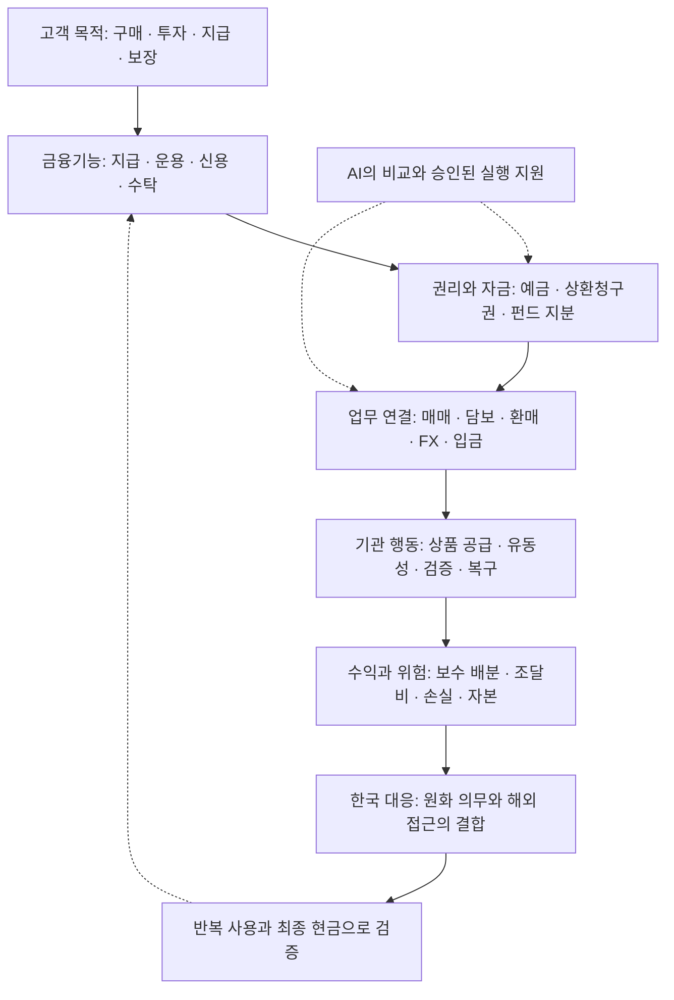
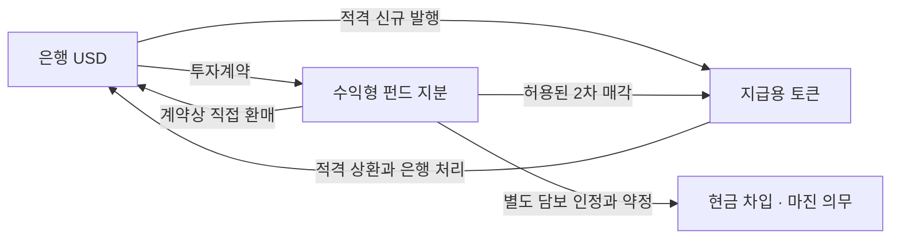
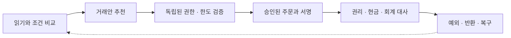

# 디지털 금융환경의 변화와 한국 금융기관의 대응

## 지급·운용·담보·AI가 연결될 때 자금과 수익은 어디로 이동하는가

**분석·확인 기준일: 2026년 11월 1일 KST · 2026년 10월 연구 종합 · 미국과 한국 중심**

이 보고서는 금융기관이 고객의 돈을 보관하고, 운용하고, 지급하며, 위험을 부담하는 방식이 어떻게 달라질 수 있는지를 설명한다. 10월 초 보고서의 경제 논리를 이어받아 이후 확인한 제도 변화, 상품 조건, 기관 행동과 자체 연구를 종합했다. 특정 기관의 채용·사업제안에 한정하지 않는 공개 연구 보고서다.

**핵심 판단은 금융기관의 경쟁 단위가 개별 상품이나 앱에서 고객의 자금 사용 과정으로 넓어질 수 있다는 것이다.** 고객은 수익률뿐 아니라 필요 시각의 현금, 적법한 권리, 실행과 복구를 함께 원한다. AI가 비교·선택 비용을 낮추고 디지털 원장이 이전·대사를 연결하면 이 과정의 분업과 보수 배분이 바뀐다. 그러나 신용·유동성·법적 집행의 책임이 없어지는 것은 아니다.

한국 금융기관의 대응은 원화 의무와 달러 접근을 연결하고, 상품·담보·현금화 조건을 기계가 읽을 수 있도록 정리하며, 기존 방식과 같은 종료조건에서 경제성을 검증하는 데서 시작할 수 있다. 기존 금융이 고객 접점을 유지하는 경로와 외부 플랫폼이 선택권을 가져가는 경로를 함께 대비해야 한다.

본문의 경제적 연결과 대응안은 **자체해석·조건부가설**이다. 공식 문서에 적힌 사실, 기관의 발표·주장, 자체 실험, 미확인은 별도로 표시한다. 이번에 확인한 자료만으로 시장 전체의 실제 비용 절감·예금 유출·수익 이동을 추정하지 않는다.

### 읽는 순서

1. [10월 초에서 무엇이 달라졌는가](#changes)
2. [금융기능과 권리의 전체 흐름](#functions)
3. [지급용 달러·수익형 자산·담보의 연결](#money)
4. [은행 조달과 한·미 자금 이동](#banks)
5. [기관별 수익과 경쟁 구도](#institutions)
6. [한국 금융기관의 세 가지 업무 사례](#cases)
7. [AI 위임과 경제 연구의 검증](#ai)
8. [실물경제·AI 인프라에서 금융으로](#real)
9. [조건부 미래 경로와 반대 시나리오](#scenarios)
10. [실행 우선순위와 다음 관측](#actions)
11. [공식 근거·귀속·한계](#sources)

## 1. 10월 초에서 무엇이 달라졌는가

한 달이 지났다는 사실만으로 산업 구조가 바뀌었다고 판단할 수는 없다. **새로운 외부 사건, 기존 사건의 재확인, 연구 방법의 진전**을 구분해야 한다. 이전 보고서도 이미 권리·위임·수탁·현금화·보수 배분을 다뤘다. 이번 개정은 그 문제의식을 업무 비교와 판별 자료로 더 구체화한다.

| 구분 | 이전 보고서의 출발점 | 11월 1일 확인한 내용 | 판단에 미치는 영향 |
|---|---|---|---|
| 실제 제도 사건 | 미국 지급 스테이블코인 제정법과 시행규칙 절차를 구분 | OCC가 **10월 21일 최종규칙 발표**, **2027년 1월 18일 효력일**을 명시 [S1](#s1) | 제안 검토에서 최종규칙에 맞춘 준비로 이동할 근거. 현재 시행·개별 인가·사업 성공과는 별도 |
| 한국 제도 재확인 | 10월 1일 STO 하위규정 입법예고를 기록 | 공식 본문은 **10월 2일~11월 11일 예고**, **2027년 2월 4일 시행 예정**을 설명 [S2](#s2) | 이번에 본문 접근을 복구했다. 새로 확정된 규칙으로 바꿔 쓰지 않음 |
| 기관 설명 추가 | 예금토큰과 중앙은행 결제를 구분 | 한은의 **10월 8일 설명**은 한강을 예금토큰·기관용 디지털화폐 기반 파일럿으로 설명 [S3](#s3) | 한국의 경로를 민간 원화 코인 발행 하나로 축약하지 않을 이유 |
| 계약·공시 버전 확인 | 기존 약관과 준비금 자료 사용 | USDC 약관 **10월 15일 개정 표시**, 준비금 화면 **10월 29일 표시** 확인 [S4](#s4)·[S5](#s5) | 버전과 직접 상환 자격을 갱신. 개정 조항 전체 diff나 잔액 변화 검증은 아님 |
| 연구의 업무 구체화 | 기업의 지급·여유자금 관리라는 일반 사례 | 보험 현금관리의 네 경로 비교와 10월 28일 가상 대사 PoC | 이전 기록과 최종 가용현금을 구분하는 실험 설계로 발전. 실제 지급 성과는 미확인 |
| 연구의 검증 구체화 | AI의 검토·정보 재사용 가능성 | 10월 24일 공시 비교 pilot과 기존 캐시 기준선 | 일부 비교 통제는 확인되지만 일반 캐시 대비 속도 우위·사람시간 절감은 주장하지 않음 |

**이번에 유지하는 판단:** 자산 이전, 상환, 은행 입금과 고객의 채무 이행은 서로 다른 단계다. 비교 비용이 낮아져도 금융기관의 순이익이 늘어나는지는 경쟁과 계약에 달려 있다.

**이번에 더 좁힌 주장:** “AI와 토큰화가 효율을 높인다”는 일반론을 같은 고객·같은 통화·같은 지급시각의 총비용 비교로 바꾼다. 기록·테스트의 존재와 실제 운영 효과도 분리한다.

**여전히 열린 질문:** 한국 민간 원화 스테이블코인의 최종 허용 구조, 개별 기관의 상품 취급·투자 자격, 현행 요율·은행 입금 계약, 반복 유료 사용과 비용 후 성과다. 선정 자료의 확인을 전 관할·전 기관의 최신 조사로 확대하지 않는다.

## 2. 금융기능과 권리의 전체 흐름

금융은 지급, 자금의 시간 간 배분, 신용·위험 부담, 정보 생산, 권리 기록과 집행을 연결한다. AI와 디지털 원장은 이 기능을 수행하는 비용·속도·조직 경계를 바꿀 수 있다. 기술의 명칭보다 **무엇이 이동하고 누가 책임지는가**가 분석의 출발점이다.

화살표는 분석 경로이며 실제 인과효과를 검증했다는 표시가 아니다. 다음 권리는 같은 지갑 화면에 표시되어도 서로 대체해서 계산할 수 없다.

| 대상 | 확인할 권리 | 별도로 확인할 종료조건 |
|---|---|---|
| 은행 예금·예금토큰 | 해당 은행에 대한 예금채권과 적용 계약 | 이체·사용 가능 잔액, 상품별 보호·반환 |
| 지급 스테이블코인 | 발행자·관할·약관별 상환 관계 | 직접 상환 자격, 중개 매도, 최종 통화 입금 |
| 토큰화 펀드 | 펀드 지분·분배·환매에 관한 권리 | 명의이전, 환매 수락, 현금 도착 |
| 토큰증권·RWA | 기초 증권 또는 중간 법인에 대한 청구권 | 담보·우선순위·부도 시 회수·공식 명부 |
| 카드·계좌의 지급용 토큰 | 기존 지급수단을 참조하는 자격정보 | 고객 동의·승인·매입·정산·환불 |

이 표는 권리를 확인하는 틀이다. 토큰 형식만으로 특정 법적 보호·자본 분류·국내 판매 허용이 생긴다는 뜻은 아니다. 기술 서명, 법적 위임, 자산 소유권도 각각 대사해야 한다.

거래비용 관점에서는 외부 연결과 검증의 비용이 낮아지면 전문기관의 분업이 쉬워질 수 있다. 반면 대형 기관의 내부 조정비가 더 많이 낮아지면 통합 우위가 강화될 수 있다. **탈중개와 재중개는 모두 가능한 반응**이며, 어느 기능의 상대비용이 변하는지로 판단해야 한다.

## 3. 지급용 달러·수익형 자산·담보가 연결되는 방식

### 3.1 지급잔액과 투자잔액은 보완하면서 경쟁한다

**공식 약관 확인:** USDC는 그 자체로 보유자에게 준비자산 이자를 지급하는 상품이 아니며, Circle에 직접 상환하려면 해당 계정 자격과 조건을 충족해야 한다. [S4](#s4) 이와 달리 펀드 지분의 수익은 기초자산 운용과 계약에 따른다. 높은 표시 수익률과 지급에 즉시 쓸 수 있는 자금은 같은 속성이 아니다.

**기관 발표:** Circle의 2024년 BUIDL 전환 기능은 지분을 Circle에 넘기고 USDC를 받는 2차시장 경로다. 펀드 환매나 은행 달러 도착과는 다르다. [S6](#s6) 이 사례는 연결 가능한 구조의 근거이며 현재 모든 고객의 가격·한도·상시 유동성을 보장하지 않는다.

**조건부가설:** 고객이 지급 직전에만 토큰을 확보하고 나머지 기간에 수익형 자산을 보유한다면 동일 결제량에 필요한 평균 지급잔액은 줄 수 있다. 동시에 사용처와 고객이 늘면 지급잔액과 펀드잔액이 함께 증가할 수도 있다. 따라서 거래량, 평균 잔액, 자산 순유입을 따로 관측해야 한다.

### 3.2 운용사는 잔액의 목적을 나누어 상품을 공급한다

**기관 발표 재확인:** BlackRock은 2026년 8월 BSTBL의 온체인 지분 클래스와 BRSRV를 발표했다. 기존 펀드의 디지털 지분과 준비금 수요 등을 겨냥한 상품을 구별한다. 이는 10월 신규 출시가 아니다. [S7](#s7) USDC 준비금에 관한 USDXX와 고객이 별도로 보유하는 BUIDL 지분도 같은 자산으로 합산하지 않는다. [S5](#s5)

**자체해석:** 운용사는 지급수단을 직접 발행하지 않아도 그 뒤의 현금관리 수요에 상품을 공급할 수 있다. 다만 운용자산 증가가 기존 클래스 이동인지 순신규 자금인지, 보수가 유통·수탁·운영비를 넘는지 확인해야 한다. 고객의 투자수익과 운용사의 보수는 서로 다른 현금흐름이다.

### 3.3 담보 편의가 생겨도 현금을 공급할 주체는 필요하다

자산을 이전할 수 있다는 것과 그 자산을 담보로 돈을 빌릴 수 있다는 것은 다르다. 담보 인정, 평가가격, 헤어컷, 마진콜, 처분권, 현금 공급자의 신용한도가 필요하다. 펀드가 국채를 보유한다고 펀드 지분의 담보권과 유동성이 직접 국채와 같아지는 것도 아니다.

**조건부가설:** 담보 이전·대사가 빨라지면 중복 선예치가 줄 수 있다. **반대 경로:** 즉시 총액결제가 기존 상계를 대체하거나 상시 마진 요구가 늘면 피크 현금 수요는 커질 수 있다. 하루 평균 처리속도보다 스트레스 시 필요한 현금과 신용 약정을 함께 비교해야 한다.

## 4. 은행 조달과 한·미 자금 이동

### 4.1 고객의 자산 전환과 은행시스템 총량을 구분한다

**설명용 회계 사고실험:** 고객이 은행예금 100으로 새 지급토큰 100을 취득하고 발행자가 이를 다른 은행에 예치한다고 가정한다. 이 단순 단계에서는 예금의 보유자·은행이 바뀐다. 이후 발행자가 국채를 매수하면 국채 매도자의 성격과 결제 경로에 따라 결과가 달라진다. 실제 거래를 재현한 수치가 아니다.

| 거래 | 먼저 바뀌는 것 | 자동으로 결론낼 수 없는 것 |
|---|---|---|
| 기존 토큰을 다른 보유자에게 매수 | 보유자와 대금의 위치 | 신규 발행량·준비금의 증가 |
| 신규 발행대금을 은행에 예치 | 고객 예금에서 발행사 예금으로 소유·집중 변화 | 은행시스템 예금 총량의 일률적 감소 |
| 비은행에게 기존 국채 매수 | 발행사 예금이 매도자의 예금으로 이동 | 정부의 신규 조달 또는 동일액의 국채 순신규 수요 |
| 신규 국채 매수 | 정부 계정과 민간 계정 사이의 결제 | 정부지출 이후까지 같은 총량 효과가 지속됨 |
| 펀드 청약 | 투자자의 현금과 펀드 지분·펀드 현금 | 기초자산 매입까지 완료되거나 새 자산이 추가 생성됨 |

**자체해석:** 은행의 위험은 총량 감소만이 아니다. 다수 소매고객 잔액이 소수 발행자·플랫폼의 예금으로 집중되면 협상력과 금리 민감도·출금 동조성이 달라질 수 있다. 은행은 고객별 평균 잔액, 재가격, 대체 조달비와 신용관계를 함께 봐야 한다. 예금 이동액을 대출 감소액에 일대일 대응시키는 방식은 자본·유동성·수요·수익성 제약을 놓친다.

### 4.2 한국의 원화 의무와 달러 수요는 함께 남는다

한국 수입기업이 원화로 달러 대금을 마련한다면 원화를 받는 FX 상대방과 달러를 공급하는 조달 경로가 존재한다. 수출기업이 USDC를 받더라도 급여·세금에 원화가 필요하면 매도 또는 적격 상환, 은행 달러, FX, 원화 입금이 이어진다. 수취인이 계속 토큰을 사용할 수 있는 거래는 별도 종료조건으로 평가한다.

달러 접근 비용 하락은 해외 자산 수요를 넓힐 수 있지만, 국내 토큰 거래량 전체를 해외 자본유출로 계산할 수 없다. 거주지, 원자금, 기존 해외자산 교체, 환전·헤지·재유입과 국제수지를 구분해야 한다. 원화 토큰은 국내 지급을 붙잡는 수단이 될 수도 있고 달러 자산으로 가는 연결 수단이 될 수도 있다.

**한국의 전략 과제:** 원화 표시 자체보다 고객이 원화를 받거나 써야 하는 이유와 낮은 전환비·신용·안정적 현금 접근을 결합해야 한다. 원화 급여·세금·대출의 수요와 달러 투자·무역의 수요를 동시에 해결하는 서비스가 후보가 된다.

## 5. 같은 변화에 기관마다 다른 수익과 대응이 생긴다

아래는 금융기능에 기초한 **전략 해석**이다. 모든 기관이 이미 해당 사업을 운영하거나 수익을 냈다는 뜻은 아니다.

| 주체 | 지키거나 확장할 기능 | 수익·편익의 후보 | 비용·위험과 다음 증거 |
|---|---|---|---|
| 은행 | 예금·기업 신용·FX·현금 접근 | 관계수익, 자금관리·전환·유동성 보수 | 예금 재가격, 유동성 집중, 기존 보수 감소. 실제 고객군별 순기여 |
| 증권사 | 자산 확보·구조화·판매·거래·사후관리 | 인수·판매·관리·집행 수수료, 위험 인수 대가 | 재고·인수 위험, 판매 책임, 외부 배분. 반복 유료 고객과 손실 후 마진 |
| 운용사 | 투자 판단·상품·환매 계획 | 평균 유료 AUM의 실효 보수 | 클래스 이동, 보수 면제, 유통·수탁·운영비. 순납입과 순보수 |
| 보험·연기금 | 부채 현금흐름·장기 투자·위험 보장 | 같은 지급능력에서 운용·대사 효율 | ALM·자본·헤지·환매 위험. 기한 내 최종 현금과 비용 후 성과 |
| 발행사·유통 플랫폼 | 지급잔액·사용처·고객 선택 | 준비자산 수익, 유통 배분, 서비스료 | 고객 보상·상환·준법비와 금리 민감도. 거래량과 잔액을 분리한 손익 |
| 수탁·명의관리기관 | 법적 권리·서명 통제·반환 | 보관·명부·정책·복구 서비스료 | 하위수탁, 배상, 공통 장애. 권리 반환과 이전 가능성 |
| 카드·PG·지급망 | 가맹점·승인·청구·분쟁·정산 | 지급·가맹점·부가서비스 대가 | 경로 전환, 사기·환불, 통합 원가. 최종 수취액과 완료건당 원가 |
| AI·클라우드·지갑 공급자 | 비교·업무 연결·운영 도구 | 구독·사용료·검증 서비스 대가 | 모델·보안·전환·장애 비용. 고객의 실제 업무 절감과 재계약 |

### 5.1 증권업의 분업과 통합이 동시에 가능하다

이전 HTML 보고서의 중요한 논리는 증권사의 상품 공급과 사후관리 역량을 자사 앱 밖에도 제공할 수 있다는 점이었다. 이번 종합에서는 이를 특정 회사의 기회에서 업권 전체의 선택으로 넓힌다. 에이전트가 상품을 비교할수록 가격·자격·환매·담보 조건이 명확한 상품이 선택되기 쉽다. 단순 상품 소개의 보수는 압박받고, 자산 실사·유동성·권리 집행·복구의 대가가 상대적으로 중요해질 수 있다.

반대로 신뢰할 데이터와 실행 능력을 한 기관이 잘 결합하면 고객은 여러 사업자를 직접 조합할 필요가 줄어든다. API 공개가 항상 분업을 확대하거나 중개기관을 없애는 것은 아니다. 고객이 누구에게 위임하고 사고 때 누구에게 청구하는지가 조직 경계를 결정한다.

### 5.2 고객 편익과 공급자 순이익을 분리한다

**관리 목적의 비교식:** 증분 순기여 = 새 외부 수입 + 검증된 내부 원가 절감 − 기존 수입 감소 − 파트너 배분 − 추가 운영·준법·조달비 − 중복 없는 기대손실·자본 부담.

회계상 순이익과 자본의 기회비용을 포함한 관리 지표는 구분한다. 계열사 사이 보수는 지급자의 비용이자 수취자의 수입이므로 그룹 분석에서는 내부거래를 제거해야 한다. 고객자산·수탁액·거래량을 매출처럼 합산할 수 없다. 비용 절감분이 고객 가격 인하로 이전되면 이용은 늘어도 공급자 마진은 낮아질 수 있다.

### 5.3 공공·시장 인프라는 수익보다 결제와 신뢰의 조건을 만든다

**대응 분석:** 민간 서비스의 편익을 중앙은행이나 감독당국의 목표와 같은 기준으로 평가할 수는 없다. 각 주체가 맡는 기능과 비용·손실의 최종 부담을 구분해야 한다.

| 주체·기능 | 함께 확인할 문제 | 대응의 판단 기준 |
|---|---|---|
| 연준·한국은행의 결제·유동성 | 민간 발행 인가와 중앙은행 계좌·신용 접근, 통화별 자금 수요 | 최종결제·정책 전달·유동성 안정. 토큰 발행만으로 공적 신용 접근을 가정하지 않음 |
| 금융위·금감원·FIU 등 감독 | 상품·법인·행위별 허용, 위탁·위임·상환·반환 책임 | 형식이 다른 같은 위험의 통제와 이용자 보호. 발표·특례·인가·일반 시행 구분 |
| 예탁·거래·청산·증권금융 | 공식 명부·발행총량, 거래 매칭, 상계·이행보증, 담보 금융 | 각 역할의 계약·참가조건과 복구. 장외 중개와 CCP 보증을 합치지 않음 |
| 공동 지급망·은행·PG | 메시지 전달, 고객 인증·지급, 은행 간 정산·반환 | 기존망과 새 기록의 정합성, 접속·가격·오류처리 조건 |
| 예금보험·정리·재정 | 보호 대상과 도산 시 회수, 공공 지급과 예산 집행 | 예금·코인·펀드의 손실 부담을 분리. 준비금 예치가 고객 토큰 전체의 예금보험을 뜻하지 않음 |

한 기관에서 비용이 줄어도 다른 기관이나 공공 부문으로 위험이 이전될 수 있다. 공통 인프라의 접근·가격·상호운용과 장애 시 반환을 함께 봐야 전체 편익을 평가할 수 있다. 위 표는 기능별 연구 질문이며 해당 기관의 신규 조치가 이미 완료됐다는 목록은 아니다.

## 6. 한국 금융기관이 검토할 세 가지 업무

### 6.1 기업 해외지급: 같은 수취인의 은행 현금으로 비교한다

**기관주장:** 신한은행의 2026년 9월 30일 발표는 기존 기업뱅킹·외화계좌를 유지하면서 후방의 스테이블코인 전송·정산과 반환을 기술 실증했다고 설명한다. 상용 이용량·총비용·순이익은 이 발표로 확인되지 않는다. [S8](#s8)

**설계 제안:** 같은 기업·같은 지급 통화·같은 수취액·같은 도착기한을 고정한 뒤 세 경로를 비교한다.

| 경로 | 고객 접점 | 추가로 필요한 증거 |
|---|---|---|
| 기존 은행·환거래망 | 기업뱅킹·은행 | 현재 총요금, FX, 중개·수취 비용, 실패·반환 이력 |
| 은행 주도 디지털 지급 | 기업뱅킹과 은행 후방 처리 | 토큰 조달·상환·현지 지급 계약, 유동성·통제·복구 원가 |
| 플랫폼 주도 디지털 지급 | 기업 업무 플랫폼 | 금융 파트너와 보수 배분, 데이터·고객 이동, 종료·대체 경로 |

네트워크 전송료가 낮아도 FX·상환·대기현금·예외 처리비가 높으면 고객 총비용은 낮아지지 않는다. 플랫폼이 고객을 확보하더라도 은행의 신용·FX·현금 공급에 의존할 수 있다. 은행은 가격 인하, ERP 연결, 신용과 지급의 묶음 제공으로 대응할 수 있으므로 첫 가격 차이를 영구적인 시장점유율 변화로 바꾸지 않는다.

### 6.2 보험·연금 현금관리: 수익보다 먼저 지급 제약을 고정한다

보험사의 외화자산에는 장기 부채를 매칭하는 자산과 담보로 묶인 자금이 포함될 수 있다. 이를 모두 단기 운용 가능한 달러로 간주할 수 없다. 법인·계정·실제 권리자·통화·지급일을 나누고 헤지·마진·자본콜까지 반영해야 한다.

| 대안 | 비교 목적 |
|---|---|
| A. 기존 계좌·상품 + 사람 | 현재 지급 안정성과 전체 원가 |
| B. 기존 계좌·상품 + AI | 예측·대사 지원의 독립적인 효과 |
| C. 온체인 경로 + 사람 | 원장·상품·현금화 경로 변경의 효과 |
| D. 온체인 경로 + AI | B에서 온체인을 추가할 때의 증분 가치 |

상품의 신용·만기·환매권이 다르면 순수 기술 비교로 표시하지 않는다. 같은 기초자산 이자를 기술 편익으로 세거나, 버퍼 감소와 같은 자금의 추가 투자 편익을 중복 계산하지 않는다. 장기채를 단기펀드로 바꾸면 유동성뿐 아니라 듀레이션·재투자위험도 달라진다.

**자체 가상 사례:** 보험 유동성 PoC는 예상 정산액 100만 원에 대해 모의 은행 입금 일치, 입금 대기, 90만 원 불일치를 구분한다. 체인 기록이 정상이어도 최종 원화가 확인되지 않으면 지급 준비 판단을 보류한다. Docker·로컬 EVM·은행 모의 서비스의 실험이며 실은행·실제 BUIDL·USDC·보험금 지급과 연결한 성과가 아니다. 검사 정의 6개와 서비스 검사 3개는 확인했지만 이번 보고서 작업에서 재실행하지 않았다. [사례 기록](../cases/02-insurance-liquidity.md)

**확대 조건:** 실제 환매·입금 SLA, 가입·보유 허용, 비용·자본 처리, 스트레스 담보와 대체 현금이 확인되고 같은 지급안정성에서 순편익이 남아야 한다. 보험계약자 자산 운용과 계열 신사업의 시험 예산·매출도 구분한다.

### 6.3 증권·운용의 RWA 관리: 발행 이후 현금흐름을 연결한다

RWA의 범위 확대는 작은 권리의 실사·계약·분배·공시·회수 비용을 낮출 수 있을 때 의미가 있다. 자산을 토큰으로 표현하는 비용만 낮아지고 원천 진위·신용·회수 비용이 그대로라면 사업성이 개선되지 않을 수 있다.

**업무 제안:** 채권·펀드·유동화 구조에서 계약상 지급기일, 실제 입금, 담보 상태, 정정 공시를 비교하고 사람의 판단이 필요한 예외를 남긴다. 발행사·운용사·수탁·대주기관은 같은 정보의 다른 부분을 필요로 한다. 정보 제공자의 보수는 반복 업무의 절감과 의사결정 가치로 검증하며, 데이터 공급을 신용위험 인수와 혼동하지 않는다.

**자체 합성 사례:** 공개 RWA 연구는 자산 8건·문서 10건을 다룬 저장 결과에서 권리·평가·담보 등 미확인을 내부 검토 또는 보류로 남긴다. 내부 검토 후보는 발행 승인·투자 적합성·유동성의 증거가 아니다. [고정 결과](https://github.com/Eom-TaeJun/sto-ai-frontier/blob/d64f570467204e2fdfa5be86ea456a501191b9f8/outputs/reports/decision_brief.md)

“상품화 가능한 권리가 넓어진다”는 미래 가설은 유지한다. 다만 상품 수가 늘수록 신뢰할 평가·회수·매수 유동성이 병목이 될 수 있다. 같은 자산군의 실제 반복 발행, 외부 투자자의 재구매, 예외 처리 포함 원가와 회수 결과가 확대의 근거다.

## 7. AI의 선택·실행과 경제 연구의 검증

### 7.1 구매 자동화가 포괄적인 금융 위임은 아니다

**기관 설명:** Stripe의 MPP는 자원 요청·지급 요청·승인·제공을 연결하며 사업자의 기존 잔액과 지급 일정에 수취를 연결한다고 설명한다. 프로그램의 주문 방식이 바뀌어도 최종 자금 수취에는 별도 운영 조건이 남는다. 3월 발표의 구조를 이번에 다시 읽은 것이며 10월 신규 성과가 아니다. [S9](#s9)

Circle의 Arc 메인넷 출시는 9월 16일 회사 발표로 확인했다. 따라서 과거 예정 표현을 그대로 반복해서는 안 되지만, 이 사건도 10월 이후의 신규 출시로 세지 않는다. 네트워크 출시와 각 기관의 반복 사용·한국 영업 허용·수익성은 별도다. [S10](#s10)

**설계 제안:** 조회, 추천, 주문, 자산 매매, 지급, 차입·담보와 재위임을 각각 정의한다. 모델 밖에서 누적 한도·수취인·자산·기간을 강제하고, 서명 전에 현재 권한과 가용현금을 대사한다. 철회는 앞으로의 실행 중지, 미처리 주문 취소, 확정 거래의 환불로 나눈다. 이미 정산한 자산을 권한 철회만으로 되돌릴 수 있다고 가정하지 않는다.

금융기관은 실행을 막는 통제뿐 아니라 고객이 제공자를 바꾸고 권리를 회수하는 절차를 제공해야 한다. 같은 모델·클라우드·수탁·체인에 대한 의존은 여러 기관을 동시에 멈출 수 있으므로 외형상 파트너 수와 실제 독립성을 구별한다.

### 7.2 연구를 기억하는 것과 예측력을 갖추는 것은 다르다

**자체 개발 pilot:** 10월 24일 공시 재검토 연구는 KB·신한 공개 문서 6건, 수치 26개, 과제 20개를 사용했다. 비교 지원은 14/20이다. 주체·범위·기간·단위·잔액/흐름을 맞추고 비교불가를 성장 신호로 처리하지 않는 것이 핵심이다. 수동 metadata와 알려진 사례를 사용한 개발 결과이며 독립 표본 성능이 아니다.

| 저장 보고의 동일 검증 포함 경로 | 각 100회 중앙값 |
|---|---:|
| 원문 text 재읽기·추출 | 93.56ms |
| 기존 list 캐시 | 70.52ms |
| dictionary 조회 | 72.96ms |

Dictionary는 이미 캐시된 list보다 느렸다. 원문 반복 읽기를 피한 점을 일반 캐시 대비 추가 속도 우위로 바꾸지 않는다. 사람의 전처리·검토·최종 판단 시간과 예측 정확도는 측정하지 않았다. 이번 보고서에서 timing을 재측정한 것도 아니다. [실험 경계](../cases/05-ai-research.md)

경제 기억의 유용성은 당시 근거·관측 시점·가설·선택을 보존하고, 새 증거가 어느 가정을 바꿨는지 설명하는 데 있다. 문자열 일치·저장량·뉴스 수집량만으로 의미 발견이나 투자성과를 입증할 수 없다. 다음 검증은 처음 보는 공시, 실제 연구자 과제, 전처리·예외·최종 판단까지 포함한 비교다.

## 8. 실물경제·AI 인프라의 변화는 금융 판단으로 어떻게 이어지는가

AI가 금융의 선택 방식을 바꾸는 동시에, AI 서비스의 구매·설비투자 자체가 기업의 자금 수요를 만든다. 연결 순서는 **기술 변화 → 고객의 품질·지연·전력 비용 → 구매와 사용 → 공급자 매출·투자 → 현금흐름·신용·자산배분**이다.

**연구자 주장:** PagedAttention 논문은 특정 비교 시험에서 메모리 관리와 처리량 개선을 보고한다. 이것은 장비 구매 증가나 산업 전체 수익률을 측정한 결과가 아니다. [S11](#s11) 같은 장비에서 요청당 자원이 줄어도 가격 하락으로 사용량이 더 늘면 총수요는 커질 수 있고, 반대로 모델·소프트웨어 변화가 고가 자원의 수요를 줄일 수도 있다.

**자체해석:** 한국 기업금융은 고객의 실제 주문, 매출채권·재고·매입채무, 장비 인수·가동과 현금 지출을 봐야 한다. 설비투자 계획을 집행으로, 기술 인증을 매출로, 한 시점 ETF 비중을 순유입으로 바꿔서는 안 된다. 운용사는 산업 성장 전망과 이미 가격에 반영된 기대를 분리해야 한다.

조달 연구의 “도착 예정 재고”와 “생산에 사용 가능한 재고” 구분은 금융의 “이전 기록”과 “지급 가능한 현금” 구분과 닮아 있다. 공급조건·검수·운송·처리시간을 빠뜨리면 자금 부족이나 조달비를 과소평가한다. 다만 `soil`의 조달 대안은 합성 가격·물량 설계이며 실제 회사 절감액이 아니다. [실물 사례와 원문 연결](../cases/06-real-economy.md)

## 9. 조건부 미래 경로와 반대 시나리오

아래는 현재 보급률이나 발생 확률의 예측이 아니다. 2027~2032년을 탐색 기간으로 두고, 어떤 조건에서 지금 준비할 선택이 유리한지 검토한다. 여러 경로가 동시에 진행될 수 있다.

| 가설 | 성립조건과 전달 메커니즘 | 기관의 준비 | 반대 경로·판단 변경 신호 |
|---|---|---|---|
| H1. 기존 계좌와 디지털 자산의 공존이 확대 | 고객은 편리한 화면을 유지하고 후방에서 적법한 지급·상품 경로를 선택 | 공통 조건 데이터, 다중 지급·수탁·FX 연결 | 기존 API만으로 편익을 달성하면 추가 체인 고정투자를 축소 |
| H2. 에이전트가 상품 선택·잔액 배분을 넓게 수행 | 실제 위임·실행권과 낮은 전환비 → 비교·이동 증가 → 유통보수 압박 | 외부에서도 읽을 수 있는 조건·가격·환매 상태, 독립 통제 | 자체 에이전트와 묶음 서비스로 기존 금융기관의 관계 강화. 고객 이동·순보수 관측 |
| H3. 토큰화 자산이 공통 담보로 확산 | 법적 담보권·헤어컷·현금 약정 확보 → 분절 선예치 감소 가능 | 담보 상태·신용한도·스트레스 유동성 관리 | 상시 마진·총액결제·동시 환매가 피크 현금 수요를 높이면 버퍼 축소 가설 수정 |
| H4. 작은 현금흐름의 상품화 범위 확대 | 검토·계약·분배의 고정비 감소와 외부 투자자 수요 | 표준 권리·상태정보·회수 관리 서비스 | 진위·집행·유동성 비용이 남거나 보수가 하락하면 발행 증가가 순기여로 연결되지 않음 |
| H5. 달러 접근 확대가 통화·조달 경쟁을 강화 | 새로운 사용자·자금과 실제 달러 사용 증가 | 한국의 원화 신용과 해외 자금관리 결합 | 기존 달러자산 재배치이거나 원화 의무·헤지가 강하면 순신규 이동 제한 |
| H6. 연결의 확대가 공동 위험을 키움 | 같은 정보·모델·유동성 공급에 의존 → 동시 행동·장애 | 독립 대체 경로, 단계별 중단·복구, 집중 한도 | 분산된 공급과 제한된 위임이 전파를 억제하는지 실제 복구·스트레스 관측 |

현재 실적이 견조하거나 아직 상용화되지 않았다는 이유만으로 미래 경로를 지울 수는 없다. 반대로 출시·MOU·파일럿을 미래 승자의 증거로 확정할 수도 없다. 각 가설의 가장 약한 연결, 예를 들어 담보 계약이나 실제 위임 범위가 확인될 때 투자 규모를 바꾸는 것이 연구의 목적이다.

## 10. 실행 우선순위와 다음에 볼 자료

### 10.1 공통 준비와 선택적 투자를 나눈다

| 단계 | 만들어야 할 결과 | 확대 기준 |
|---|---|---|
| 공통 준비 | 법인·계정·통화·권리·만기·가용시각·보수·책임을 연결한 업무 지도 | 운영·리스크 담당이 현재 흐름과 미확인을 대사 |
| 비교 설계 | 같은 고객·수취액·기한의 기존/AI/온체인 대안 | 상품 위험 차이와 전환·예외 비용까지 포함한 기준선 확보 |
| 그림자 운영 | 자금을 움직이지 않는 추천·대사와 실패 시나리오 | 누락·중복·잘못된 권한·미확인 현금을 정상 처리하지 않음 |
| 제한된 실제 운영 검토 | 필요한 허용·계약·한도·인력·복구 체계 | 최종 현금, 스트레스, 사고·오류와 전체 원가를 검증 |
| 외부 유료 확대 | 고객별 반복 수요·파트너 배분·순기여 | 내부 사용량이나 발표 건수가 아니라 외부 계약·유지·손실 후 경제성 |

직접 구축과 제휴는 통제권·고정비·종료·대체 가능성으로 비교한다. 같은 고객 편익을 기존망 개선으로 얻을 수 있으면 그 경로도 선택지다. 고객자산의 운용 타당성과 플랫폼 신사업의 타당성을 각각 심사해야 한다.

### 10.2 관측은 판단을 바꾸는 질문에 맞춘다

| 관측 질문 | 자료와 단위 | 판단에 쓰는 방식 |
|---|---|---|
| 실제로 허용된 업무가 늘었는가 | 법령·최종규칙·효력일·개별 인가·계약 | 제안·확정·시행·인가를 순서대로 분리 |
| 지급 수요가 잔액 수요로 이어지는가 | 발행/상환, 평균/기말 잔액, 기간 결제량 | 토큰 회전과 순신규 수요를 구분 |
| 상품이 새 자금을 끌어오는가 | 순납입, 클래스 이동, 가격·환율 효과 | AUM 증가의 원인을 나눔 |
| 은행 조달이 비싸지거나 불안정해지는가 | 고객군별 금리·평균잔액·집중도·대체조달 | 시스템 총량과 개별은행의 손익·유동성을 구분 |
| 고객 업무가 실제로 개선됐는가 | 모든 시도 대비 완료·실패, 최종 입금시간·총원가 | 성공 건만 골라낸 속도·비용 비교를 피함 |
| 공급자가 지속 가능한 대가를 받는가 | 실효 보수, 배분·보상·준법·조달·복구·손실 | 총수입과 증분 순기여를 대사 |
| AI가 판단을 개선하는가 | 미관측 표본, 사람 검토시간, 오류·정정·기준모형 | 작은 개발 실험과 일반 성능을 분리 |

국제수지·자금순환·은행 통계·기관 공시는 거시 배경과 경쟁 설명을 제공한다. 이 총량만으로 디지털화의 인과효과를 식별할 수는 없다. 금리·환율·재정·경기·상품 가격과 자료 개정도 함께 기록해야 한다. 관측 불가를 변화 없음이나 실패로 바꾸지 않는다.

## 11. 공식 근거·귀속·확인 한계

### 11.1 선정 공식 원문

확인일은 2026-11-01 KST다. 웹 도구가 제공한 본문을 읽었으며 동적 데이터 전체·첨부 계약·과거 판본의 완전한 대조를 의미하지 않는다. 공식 발표도 해당 기관의 주장·계획과 실측 성과를 구분해 사용했다.

| 출처 | 문서·사건일과 읽은 위치 | 근거의 경계 |
|---|---|---|
| S1 [OCC 최종규칙 발표](https://www.occ.treas.gov/news-issuances/news-releases/2026/nr-occ-2026-92.html) | 2026-10-21, 적용 대상·효력일 본문 | 최종규칙 발표·2027-01-18 효력일. 조문 전수·개별 인가 미검증 |
| S2 [금융위 STO 하위법규 입법예고](https://fsc.go.kr/po010106/87838?curPage=1&srchBeginDt=&srchCtgry=6&srchEndDt=&srchKey=&srchText=) | 2026-10-01 표시, 추진배경·주요내용·향후계획 | 공식 대체 게시 경로에서 본문 확인. 예고 단계와 시행 예정을 확정 시행으로 바꾸지 않음; 첨부 전문 미대조 |
| S3 [한국은행 프로젝트 한강 설명](https://www.bok.or.kr/portal/bbs/B0000347/view.do?menuNo=201106&nttId=11065408) | 2026-10-08, 파일럿·예금토큰·기관용 디지털화폐 절 | 제도·설계의 구분. 금융안정 효과에 관한 기관 견해를 독립 실증으로 사용하지 않음 |
| S4 [USDC 약관](https://www.circle.com/legal/usdc-terms) | 2026-10-15 개정 표시, §1–2 | 비EEA 약관의 이자·직접 상환 조건. 한국 고객별 자격 미판정 |
| S5 [Circle 준비금 공개](https://www.circle.com/transparency) | 2026-10-29 표시, 구성·관리 설명 | 동적 잔액 수치 미확보. 잔액 변화·시장점유율을 추정하지 않음 |
| S6 [BUIDL–USDC 기능 발표](https://www.circle.com/pressroom/circle-announces-usdc-smart-contract-for-transfers-by-blackrocks-buidl-fund-investors) | 2024-04-11, 2차시장 교환 설명 | 역사적 기능 발표. 현재 견적·실사용·은행 도착 미확인 |
| S7 [BlackRock BSTBL·BRSRV 발표](https://www.blackrock.com/cash/en-us/press-release-t3) | 2026-08-03, 상품과 지분 클래스 설명 | 출시·목표 고객의 근거. 현행 개별 계약·실현 보수 미확인 |
| S8 [신한 기업 해외송금 실증](https://shinhangroup.com/kr/archive/press/detail/950) | 2026-09-30, 실증·향후 계획 | 기술 실증 발표. 상용 사용·순절감 미확인 |
| S9 [Stripe MPP](https://stripe.com/blog/machine-payments-protocol) | 기존 2026년 3월 발표, How MPP works | 회사가 설명한 요청·지급·수취 구조. 한국 허용·전체 고객 ROI 미확인 |
| S10 [Circle Arc 메인넷 발표](https://www.circle.com/pressroom/circle-launches-arc-mainnet-an-economic-operating-system-for-the-internet) | 2026-09-16, 출시·기관 생태계 설명 | 회사 발표상 출시. 반복 사용·각 참여기관의 수익·한국 허용과 별도 |
| S11 [PagedAttention v1](https://arxiv.org/abs/2309.06180v1) | 2023-09-12, 초록·시험 보고 | 기술 성과의 조건부 근거. 장비 수요·금융 ROI 아님 |

### 11.2 기존 보고서와 이번 종합의 관계

사용자가 지정한 [기존 HTML 보고서](https://github.com/Eom-TaeJun/sto-ai-frontier/blob/main/reports/digital-finance-agentic-securities.html)의 핵심 견해·목차·금융기능·기관 대응·증권업 구조를 참고했다. 10월 5일 기준의 기존 Markdown 보고서는 고객 거래→권리·위임→기관 손익→미국·한국 대응→관측이라는 논리를 제공했다. 이전 자료를 최신 외부 사실의 대용으로 쓰지 않고, 이번에 채택한 주요 단정은 위 공식 근거로 연결했다.

이번 종합에 사용한 10월 이후 저장소와 실제 읽은 범위는 [조사 방법](../METHOD.md)에 있다. 이번 보고서는 그 원문 모두를 재독하거나 모든 코드 실험을 재현한 결과가 아니다. 비공개 연구는 공개용으로 새로 서술했고 내부 원문·개인 필기·지원서·계정정보를 포함하지 않았다.

교수의 공개 강의, 사용자의 필기, 후대 AI 정리, 자체 연구 해석은 서로 다른 층이다. 원문 수집량을 독자적인 실증성과로 세지 않으며, 이 보고서의 기관 대응안과 미래 가설을 교수의 견해로 귀속하지 않는다. AI가 선정 자료 조회·구성·작성·검증을 지원했다. 보고서의 공개 허용과 모든 사실·판단에 대한 사용자의 개별 검토는 구분한다.

### 11.3 남은 확인

앞선 사례 카드 작성에서는 금융위 두 링크의 접근에 실패했다. 이번에는 **87838 입법예고문만 공식 대체 경로에서 본문을 확인**했다. 87650 정책방향 문서의 직접 재확인, 후속 확정 법령 전수, 민간 원화 스테이블코인·CLARITY 전체 진행 상태, 세부 보험자산·자본·회계 판단은 완료하지 않았다.

실제 고객별 계약·최종 요율·현금 도착·손실·사람시간·기관 순기여도 미확인이다. 따라서 이 보고서는 특정 기술이나 기관의 승리를 확정하는 성과 보고가 아니라, 금융 변화의 메커니즘과 다음 대응을 검증 가능한 질문으로 연결한 연구 종합이다.
